<p align="center"></p>

<p align="center"><a href="README.md">中文</a> · <b>English</b></p>

# Flower Field Magic · 花田魔法

Raise your phone's camera, tap or swipe, and a field of flowers blooms around you. The flowers stay planted on the real ground or tabletop, so you can walk around them, crouch down for a closer look, and take a photo.

It's a plain web page with no app to install. Open it in your phone's browser. So far it has mainly been tested on iPhone Safari.

## What it does

- **Touch the screen and a sea of flowers blooms.** Tap or swipe, and flowers open outward from where your finger lands. Parts of a swipe that cross the horizon become flowers floating in the air.
- **Flowers stay put.** AR world tracking plants the flowers on the real ground, so they stay in place when you walk, turn around, or switch to another app and come back. Until AR is ready, the gyroscope is used and the flowers turn with your view.
- **Five palettes**

  | Palette | Flowers |
  |---|---|
  | Moonlit | Baby blue eyes, hydrangea, lily of the valley |
  | Spring | Cosmos, daisy, sunflower, freesia |
  | Meadow | All of the above plus pink tulips, mixed together |
  | Bloom | Ranunculus and tulips in six colours, red roses |
  | Single | Just one kind |

- **Ground or tabletop.** Tabletop mode uses smaller flowers for a little cluster on a desk.
- **Adjustable.** Brush (patch or cluster), grass on or off, stems, and density. Pinch to resize new flowers or to zoom the view.
- **Photos.** The shutter button captures the current view, and you can save it to your photos or share it.
- **中文 / English.** Follows your system language; switch it from the top-right corner of the start screen.

## Privacy

Camera frames are processed only on your phone. Nothing is uploaded or stored on a server, and there is no analytics or tracking. A photo is handed to the system only when you tap "Save / Share".

## How it works

- React 19, TypeScript and Vite, with three.js for 3D.
- **Meadow engine.** Each flower species is drawn with instancing, one draw call per variant. Blooming, growth and wind are computed in the vertex shader, so the CPU only updates a time value each frame. A plant has roughly 200 to 900 triangles, and a phone stays smooth with several hundred thousand triangles on screen. When the budget is exceeded, the extra flowers wither gradually instead of a whole patch disappearing.
- **Flower shapes.** All geometry is generated in code with no textures; colours are stored per vertex.
- **AR.** World tracking comes from the 8th Wall Engine's SLAM, plus a custom pose filter. The filter locks heading to the gyroscope, rejects jumps and slow drift, freezes position while the phone lies flat, and uses a small dead zone to remove jitter when still. After you switch apps, it uses the compass to turn the field back to where it was.
- **Start screen.** A live watercolour painting drawn in raw WebGL, with wet-on-wet washes, flowers swaying in the wind, paper grain and brush texture. The title is hand-lettered.

## Local development

```bash
npm install
npm run dev          # dev server
npm run build        # type-check and build to dist/
npm run preview      # preview the build locally
```

Testing on a phone needs HTTPS, and it should use a built version (the dev server reloads the page when the phone puts it in the background). Use the **test build** on phones; it includes the `?debug` tools below. A Cloudflare quick tunnel can expose the local preview to your phone:

```bash
npm run build:lab && npm run preview:lab -- --port 5180
cloudflared tunnel --protocol http2 --url http://localhost:5180
```

The production build (`npm run build`, `npm run deploy`) contains no test tools at all; they are stripped out at build time.

URL parameters:

| Parameter | Effect |
|---|---|
| `?lang=en`, `?lang=zh` | Set the interface language |
| `?debug` | Dev server and test build only: show the build and frame rate; "Send" saves diagnostics and a screenshot to `probe/reports/` on your computer (not committed) |
| `?fakecam` | Use a simulated camera when debugging on a computer (dev server only) |
| `?ar=force` | Run the switch to AR on a computer (dev server only) |

`/meadow-lab.html` is the meadow lab: `?specimen=tulip&view=特写` shows a close-up of one species, and `?pre=盛放&view=近` shows a whole field.

## Deployment

It's a static site. `wrangler.jsonc` serves `dist/` as Cloudflare Worker static assets. Before deploying, create a local `.env.local` (not committed) with the production URL, so the share card's image URL is absolute:

```bash
echo "SITE_URL=https://your.domain" > .env.local
npm run deploy
```

## Layout

- `src/screens/`: start screen and camera screen
- `src/art/`: the start screen's watercolour painting and hand-lettered title
- `src/engine/`: the meadow engine (`meadow.ts` instanced rendering, `species.ts` flower shapes, `field.ts` gestures to flowers, `stages.ts` the gyroscope and AR stages and the pose filter)
- `src/lib/`: permissions, Chinese and English text (`i18n.ts`), and so on
- `src/lab/` and `meadow-lab.html`: the meadow lab (development only)
- `docs/`: images for the README

## Known limitations

- Web AR has limited precision. The field can drift slightly with fast movement, when the phone lies flat, or very close to a tabletop; tabletop mode shows it more than ground mode.
- There is no occlusion. A hand or object in front of the flowers is still drawn behind them.
- Tested mainly on iPhone Safari. Android and other browsers haven't been tested systematically.
- The AR engine is about 2 MB, so the first load can take a while on a slow connection; gyroscope mode is used until it's ready.

## Third-party software and credits

- **8th Wall Engine** (npm package `@8thwall/engine-binary`): a closed-source binary used under its license. It is copied from the npm package to a versioned folder, `/xr/<version>/`, at build time and is not committed to this repository. The copyright and license notice is shown in the interface while AR is in use.
- **851 GBai marker font**: the four characters of the Chinese title "花田魔法" on the start screen come from this font (original by 8:51:22 pm, extended CJK by lamda05). Only the shapes of these four characters are stored, not the font file, and a broken stroke in "魔" has been joined. The license allows free commercial use, modification and embedding without attribution; the font may not be sold on its own and authorship may not be claimed. See the [author's terms](https://pm85122.onamae.jp/851fontTerm.html) and [Maoken's notes](https://www.maoken.com/freefonts/27979.html).
- **three.js**, **React**: MIT License.

## Copyright

© 2026 SummerPapaya. All rights reserved. This repository is public for viewing and learning only. Without written permission you may not copy, modify or distribute the code, artwork or design of this project, or use any of it commercially. See [LICENSE](LICENSE). Third-party components are under their own licenses.
